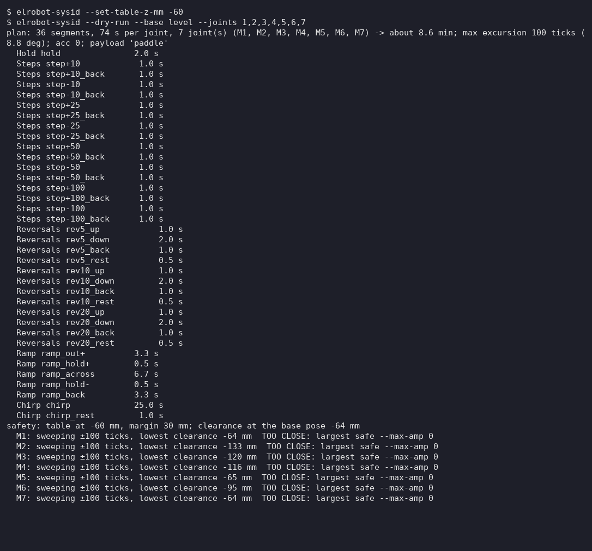

# ElRobotSysId

Per-joint system identification of the **ElRobot** follower's Feetech ST3215 servos. It records the data needed to give a
**MuJoCo** model of the arm realistic actuators (sim2real2sim), for
[RoboSim #69](https://github.com/spinworks-tech/RoboSim/issues/69). The balancing controller that motivated it is in
[PingPongSimBot](https://github.com/robomotic/PingPongSimBot).

The first real ping-pong runs showed that **the servos dominate the real behaviour**: about 150 ms from goal to position and
about 1.7° of slop on M6. A simulator without those effects won't transfer in either direction. This tool measures them.


**Download:** prebuilt Raspberry Pi 4/5 (aarch64) binaries are on the
[Releases](https://github.com/robomotic/ElRobotSysId/releases) page (`elrobot-sysid-aarch64-linux` + `.sha256`). They need glibc ≥ 2.34 (Raspberry Pi OS bookworm/trixie, Ubuntu 22.04+)
and no other libraries. Otherwise, build from source as below.
## What it does

It excites **one joint at a time** around a base pose while all other joints hold (the gripper keeps its grip). It logs goal,
position, speed, load and current at the **full bus rate** (several hundred Hz, using direct serial access).

| Test | Signal on the joint | Identifies (MuJoCo) |
|---|---|---|
| hold | 2 s still | static gravity load and current at the pose |
| steps | +a, 0, −a, 0 for a = 10, 25, 50, 100 ticks | dead time, lag (`dyntype="filter"` / delay), `kp`, `damping`, overshoot |
| reversals | slow triangles of ±5, 10, 20 ticks | slop: backlash / dead zone (modelled in the control wrapper) |
| ramp | out and back at 15 ticks/s | `frictionloss` (breakaway current), compliance under load |
| chirp | 20 ticks, log sweep 0.2 → 4 Hz over 25 s | frequency response: bandwidth, phase lag; checks `armature`/`damping` |

About **74 s per joint**: about 3.7 min for the wrist (M5–M7). 4096 ticks = one turn (1 tick ≈ 0.088°).

## What it looks like

`elrobot-sysid` is a command-line tool (no full-screen app yet). A dry run prints the test plan and the safety report,
and moves nothing:


<details>
<summary>Dry run with a table height set: per-joint clearance and the largest safe amplitude</summary>



Every joint reads **TOO CLOSE** here. That is the expected fail-safe result while the geometry is not calibrated on the
real arm (see [Table safety area](#table-safety-area-required-before-any-run)): the model puts the tool below the base at
the level pose, so nothing is allowed to move.
</details>

## Build (on the Pi)

```bash
curl https://sh.rustup.rs -sSf | sh -s -- -y --profile minimal
sudo apt install protobuf-compiler libudev-dev    # st3215 build.rs (protoc), serial port
cargo build --release
cargo test                                        # 7 tests: signals, step/slop estimators, settings
```

`st3215` (the ST3215 packet codec and register map) comes from [norma-core](https://github.com/norma-core/norma-core) as a pinned git
dependency.

## Run

```bash
sudo systemctl stop normacore-station          # this tool needs exclusive use of the follower bus
B=target/release/elrobot-sysid

$B --dry-run                                   # the plan and its duration; nothing moves
$B --joints 5,6,7 --payload paddle             # wrist with the paddle in the gripper; asks [y/N] first
$B --joints 1,2,3,4 --payload none --max-amp 50   # shoulder/elbow, paddle removed, smaller moves
$B --joints 6 --tests steps,reversals --acc 100    # a subset, with the acceleration paddle-balance uses

sudo systemctl start normacore-station
```

Options:

| Option | Meaning |
|---|---|
| `--port` | follower bus. Default: `/dev/serial/by-id/usb-1a86_USB_Single_Serial_5B14033257-if00` |
| `--config paddle.toml` | optional PingPongSimBot config: port, level pose and grip are read from it |
| `--base current\|level` | test around the current pose (default) or the `level` pose from the config |
| `--max-amp` | largest excursion in ticks (default 100, hard cap 200) |
| `--acc` | servo acceleration register during the tests (0 = servo maximum); restored afterwards |
| `--tests` | any of `hold,steps,reversals,ramp,chirp` |
| `--payload` | label for what the arm carries: goes into the folder name and the metadata |
| `--yes` | skip the confirmation |
| `--safety sysid_safety.toml` | table height, margin, tool spheres, tick→angle convention |
| `--set-table-z-mm` | record the measured table height (base frame) and exit |
| `--show-clearance` | read-only: modelled heights and clearance at the current pose |

## Table safety area (required before any run)

The arm sits on a table and must never hit it ([issue #1](https://github.com/robomotic/ElRobotSysId/issues/1)):

```bash
$B --show-clearance                 # read-only: modelled height of every joint and tool sphere now; compare with a ruler
$B --set-table-z-mm 0               # MEASURED table height in the robot base frame (mm); runs are refused until set
$B --dry-run --base level           # per joint: lowest clearance over the planned sweep, and the largest safe --max-amp
```

- Forward kinematics with positions (URDF joint origins); the gripper and paddle are modelled as spheres in the
  gripper frame (`tool_spheres` in `sysid_safety.toml`, conservative by default).
- Before anything is written to the servos: every joint's full planned sweep (and the move to the base pose) must stay
  at least `margin_m` (30 mm) above the table, or the run is refused with the largest safe amplitude per joint.
- While running: the measured pose is checked every sample; below the margin the joint stops and returns to base.

**Status (2026-11-20): the geometry is not verified on the real arm yet.** With the assumed tick→angle convention
(`sign = -1`, `zero = 2048` for every joint) the model puts the tool *below* the base at the level pose, which can't be
right, so the check refuses everything (it fails safe). Before the first run: compare `--show-clearance` with a ruler,
and fix the per-joint `sign`/`zero` in `sysid_safety.toml`. The reference is the station web viewer's mapping, which
spreads each motor's calibrated tick range over the URDF joint limits.

## Output

`sysid_logs/<unix stamp>_<payload>/`:
- `meta.toml`:
  - run arguments, base pose and start pose;
  - the **EEPROM and RAM settings of all 8 servos**: P/D/I coefficients, CW/CCW dead zones, max torque, protection current,
    offset, acceleration, torque limit, plus raw hex;
  - a **per-joint summary**: hold load and current; for each step, dead time, t63, overshoot and steady error; reversal slop;
    ramp peak current.
- `M<n>.csv`: one row per bus sample, with columns
  `t, segment, test, goal, position, speed, load, current_ma, voltage_dv, temp_c`.

Units: position and goal in ticks (4096 per turn); speed in ticks/s (sign-magnitude decoded); load in 0.1% of max torque
(signed); current in mA (6.5 mA per raw unit); voltage in 0.1 V.

## Safety

- Excursions are capped at 200 ticks (17.6°).
- Before anything moves, all 8 servos must answer.
- It stops when a joint stays at ≥ 90% load for 0.3 s (blocked), ends up more than 300 ticks from its goal (collision or slip), or 5
  reads in a row fail.
- Ctrl-C, or any of those stops, brings the joint back to base. The acceleration register is restored.
- M8 (gripper) is never excited. Its saved grip (from the config) is re-applied at start.

## Using the data in MuJoCo (plan)

1. Position actuator per joint: `kp` from the step steady error under the known gravity load (hold test) and the step speed;
   `forcerange` from ST3215 stall torque (2.94 N·m in the URDF), checked against the load at saturation.
2. Lag: first-order filter time constant plus a pure delay, fitted to the step responses and the chirp phase.
3. `damping` and `armature` (rotor inertia × gear ratio²) from overshoot and chirp; `frictionloss` from the ramp.
4. Slop: MuJoCo has no native backlash in the 3.x API. Add a deadband in the control wrapper with the measured reversal slop
   (check what MuJoCo 4.1 offers first).
5. Validate by replaying logged goal sequences, from these runs and from PingPongSimBot runs, in sim and comparing positions.

## License

Apache License 2.0, see [LICENSE](LICENSE).
