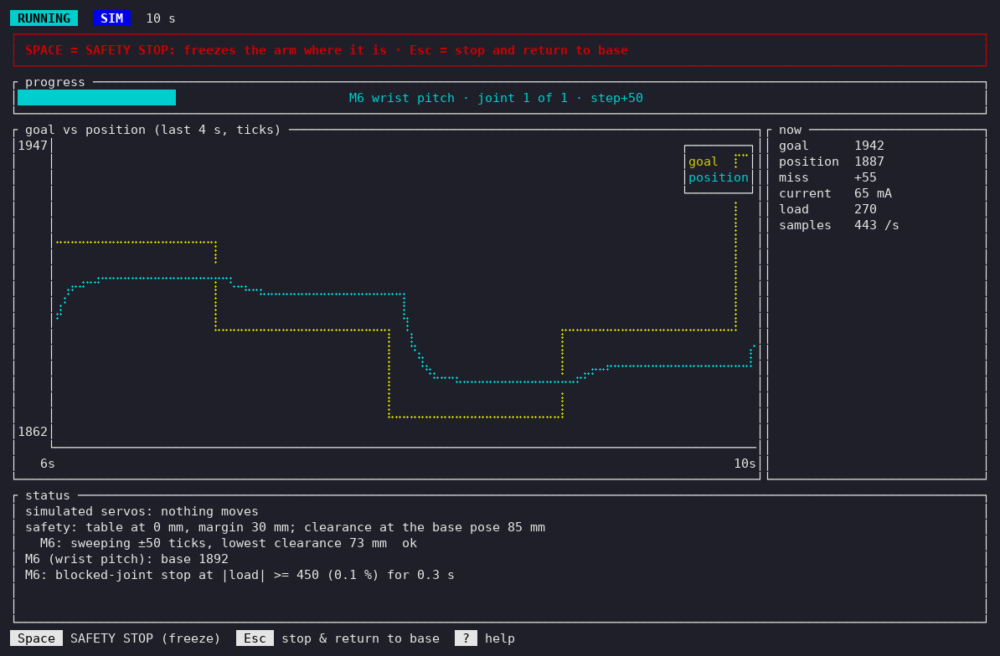
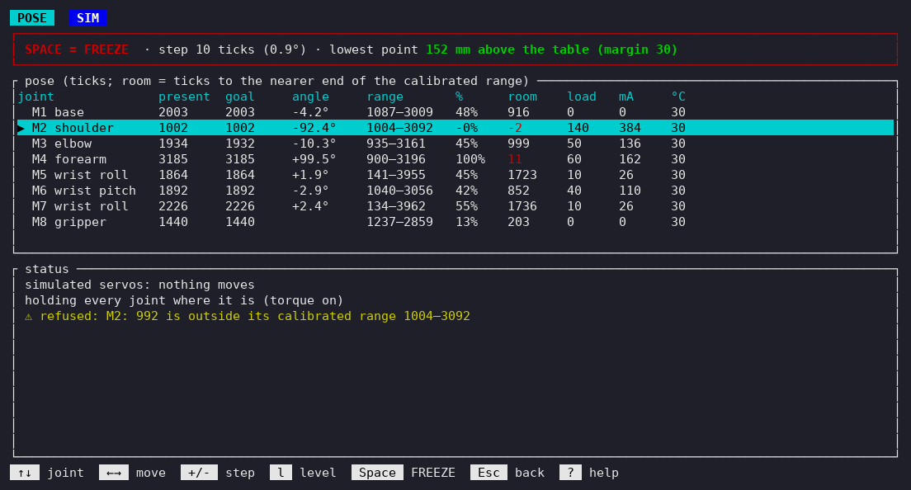
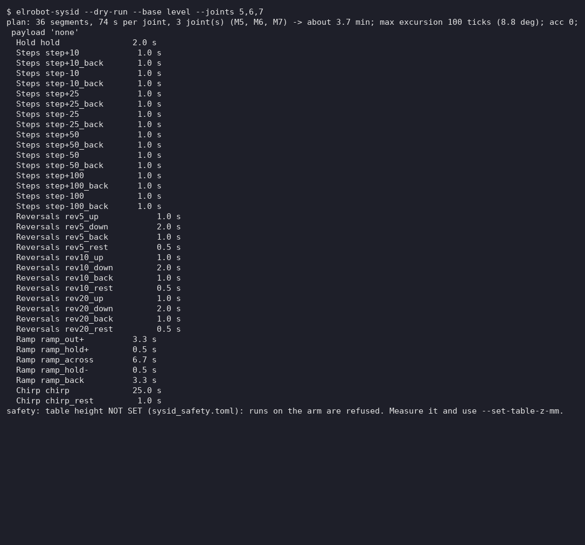
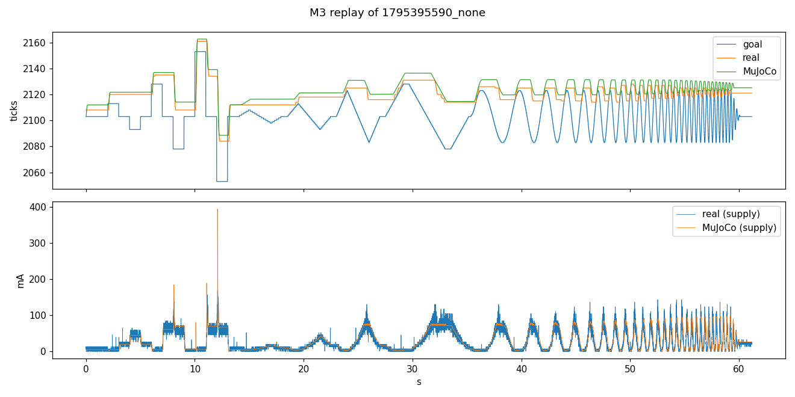
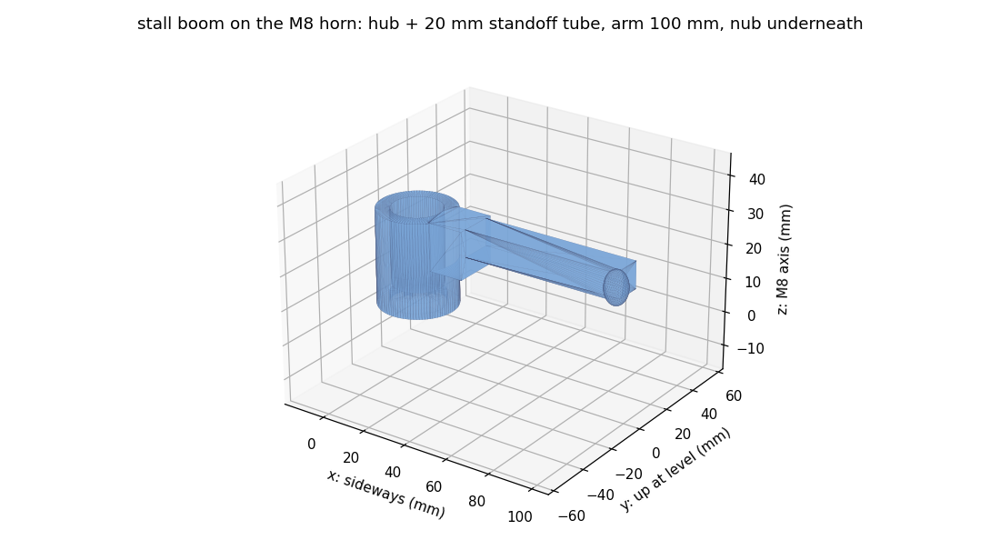

# ElRobotSysId

System identification of the **ElRobot** follower's Feetech ST3215 servos, and a servo model that reproduces them in
**MuJoCo** (Python) and in **Unity** (C#), for [RoboSim #69](https://github.com/spinworks-tech/RoboSim/issues/69)
(sim2real2sim). The balancing controller that motivated it is
[PingPongSimBot](https://github.com/robomotic/PingPongSimBot): its real runs showed that the servos dominate the real
behaviour (about 150 ms from goal to position, a 1 Hz limit cycle on M6). A simulator without those effects won't
transfer.

**Results so far** (details in [docs/SERVO_MODEL.md](docs/SERVO_MODEL.md)):
- The model (firmware P loop with dead zone and duty cap, DC motor, gearbox stiction, protection, heating) predicts
  **held-out** real runs to **0.30–0.37° RMS** on M2, M3, M4 and M7 (1.5–1.8 mm at the fingertip).
- Measured on the real servos: R ≈ 4.1 Ω, Ke·N 1.5–2.0 V·s/rad, Kt·η·N 1.6–1.8 N·m/A, static friction 0.26–0.41 N·m
  under load; the current register is the **supply** current (duty × motor current).
- Per-joint values: [`servo_params.toml`](servo_params.toml). The calibrated safety set-up:
  [`sysid_safety.toml`](sysid_safety.toml). The raw runs: [`data/sysid_runs/`](data/sysid_runs).

| Where | What |
|---|---|
| `src/` | `elrobot-sysid`, the Rust tool for the Pi: full-screen app, sysid tests, Pose screen, stall test, safety model |
| `tools/` | Python analysis: fitters, MuJoCo servo model, replays, statistics, videos (see [Analysis](#analysis)) |
| `unity/` | the servo model in C# for MuJoCo in Unity, its MjScene driver, and checks |
| `docs/SERVO_MODEL.md` | registers, equations, parameters, method, validation, MuJoCo and Unity implementation |
| `data/sysid_runs/` | the five real-arm runs every result comes from |
| `servo_params.toml`, `sysid_safety.toml` | fitted servo parameters; calibrated safety set-up (table, ranges, tick→angle, tool spheres) |
| `hardware/` | printable stall-test boom for the M8 horn |
| `docs/videos/`, `docs/stats/`, `docs/plots/` | real-vs-sim videos, validation tables, plots |

Prebuilt Raspberry Pi 4/5 (aarch64) binaries: [Releases](https://github.com/robomotic/ElRobotSysId/releases)
(`elrobot-sysid-aarch64-linux` + `.sha256`; glibc ≥ 2.39, e.g. Debian 13 / Raspberry Pi OS trixie, Ubuntu 24.04+).
The latest release is **v0.3.0** (2026-11-23): calibrated safety, Pose screen, stall test. Run it from a folder that
has `sysid_safety.toml`.

## What the tool does

It excites **one joint at a time** around a base pose while all other joints hold (the gripper keeps its grip), and logs
goal, position, speed, load, current, voltage and temperature at the **full bus rate** (~2 kHz, direct serial access).

| Test | Signal on the joint | Identifies |
|---|---|---|
| hold | 2 s still | static load (zero under gearbox stiction) |
| steps | ±a and back for a = 10, 25, 50, 100 ticks (up to the amplitude) | dead time, t63, overshoot, steady miss; firmware P (duty per tick) |
| reversals | slow triangles of 5, 10, 20 ticks | slop: backlash + dead zone |
| ramp | 15 ticks/s out, across and back, with holds at each end | friction; the two-sided holds give torque per amp and static friction |
| chirp | log sweep 0.2 → 4 Hz over 25 s | bandwidth, phase lag; back-EMF (Ke·N) from duty against speed |

About 56–74 s per joint depending on the amplitude. 4096 ticks = one turn (1 tick ≈ 0.088°).

## Full-screen app

`elrobot-sysid` with no arguments opens a keyboard-driven app (the same keys as PingPongSimBot);
`elrobot-sysid --sim` runs it on **simulated servos** (the real arm's delay, dead zones and duty slope), so nothing
moves.





**Pose screen** (`p` in Setup): move the arm **without the station**, e.g. to a better base pose before a run. ↑↓
choose a joint (M1–M8), ←→ move it one step (1 · 5 · 10 · 25 · 50 ticks with `+`/`-`), `l` goes smoothly to the level
pose, `g` to the pose given with `--target t1,…,t7` (all joints together), **Space freezes**, Esc releases the bus.
Every step and every smooth move is checked first: inside the joint's calibrated range (± 5 ticks) and the whole path
keeps the table margin; while moving, the measured pose is checked every 30 ms.



<details>
<summary>More: confirmation, results, dry runs</summary>



</details>

| Key | |
|---|---|
| ↑ ↓ | move between joints, tests and settings |
| Space | tick / untick a joint or test |
| ← → | amplitude, acceleration, base pose, payload |
| Enter | start (real arm: needs ARMED and a measured table height; asks first) |
| a | ARM / disarm (switches itself off after 30 s without a key) |
| p | Pose screen |
| **Space** | **while running: SAFETY STOP**: freezes the arm where it is (goal = present position, torque stays on so nothing drops). Then `r` returns slowly to base, `q` leaves it there |
| Esc | while running: stop gently, the joint returns to base · otherwise quit |
| Ctrl-C | emergency: freeze, leave the arm where it is, quit |
| ? | help |

A frozen joint stops after the servo's response delay (~80 ms); if it was moving fast it coasts about 1° and settles in
its dead zone. Line-based runs (`--cli`): Ctrl-C stops and returns to base; a second Ctrl-C skips the moves back.

## Build and run (on the Pi)

```bash
curl https://sh.rustup.rs -sSf | sh -s -- -y --profile minimal
sudo apt install protobuf-compiler libudev-dev    # st3215 build.rs (protoc), serial port
cargo build --release
cargo test                                        # 25 tests: signals, estimators, safety, jog, stall fit, simulated servo
```

`st3215` (packet codec and register map) comes from [norma-core](https://github.com/norma-core/norma-core) as a
pinned git dependency.

**Run it from the repository folder**: it reads `sysid_safety.toml` and writes `sysid_logs/` in the current folder
(from elsewhere it falls back to the uncalibrated model without a table height and refuses every run).

```bash
sudo systemctl stop normacore-station          # this tool needs exclusive use of the follower bus
cd ~/ElRobotSysId
elrobot-sysid --config ~/paddle-ws/paddle.toml                  # full-screen app on the real arm
elrobot-sysid --sim                                             # simulated servos: try it anywhere
elrobot-sysid --config ~/paddle-ws/paddle.toml --dry-run        # plan + safety report; nothing moves
elrobot-sysid --cli --joints 5,6,7 --max-amp 50                 # line-based run; asks [y/N] first
elrobot-sysid --config ~/paddle-ws/paddle.toml --target 2001,1750,2100,2450,1881,1869,2244   # g on the Pose screen
sudo systemctl start normacore-station
```

| Option | Meaning |
|---|---|
| `--config paddle.toml` | PingPongSimBot config: port, level pose and grip are read from it |
| `--port` | follower bus. Default: `/dev/serial/by-id/usb-1a86_USB_Single_Serial_5B14033257-if00` |
| `--joints`, `--tests` | joints 1–7 (M8, the gripper, is never excited by the tests); any of `hold,steps,reversals,ramp,chirp` |
| `--base current\|level` | test around the current pose (default) or the `level` pose from the config |
| `--max-amp` | largest excursion in ticks (default 100, hard cap 200; also limited by each joint's calibrated range) |
| `--acc` | servo acceleration register during the tests (0 = servo maximum); restored afterwards |
| `--payload` | what the arm carries: `none` (normal), `boom` (stall boom), `paddle`, `paddle+ball`; the last three add it to the safety model |
| `--target t1,…,t7` | the pose the Pose screen's `g` goes to |
| `--cli`, `--yes`, `--sim`, `--dry-run` | line-based run; skip its confirmation; simulated servos; plan + safety report only |
| `--safety sysid_safety.toml` | the safety set-up to use |
| `--set-table-z-mm`, `--show-clearance` | record the measured table height and exit; read-only clearance report at the current pose |
| `--stall J --into ±1 --lever-mm L [--stall-max 20]` | the stall test (below) |

## Safety

The arm sits on a table and must never hit it ([#1](https://github.com/robomotic/ElRobotSysId/issues/1)).
[`sysid_safety.toml`](sysid_safety.toml) holds the **checked configuration of this follower**: tick→angle
(`sign = +1`, `zero` from the station viewer's mapping), the calibrated ranges, the table at 0 mm (base clamped onto the
table), and spheres for the gripper, the wrist camera (fitted to RoboSim's CAD-registered U20CAM), the paddle and the
stall boom. It was checked with the station viewer, `--show-clearance` and a ruler. **On another arm**, measure your own
table height (`--set-table-z-mm`) and check your calibrated ranges and zeros before anything moves.

- Before anything is written to the servos: all 8 servos must answer; every joint's planned sweep and the move to the
  base pose must stay ≥ 30 mm above the table and inside the joint's calibrated range (± 5 ticks).
- While running: the measured pose is checked every sample (below the margin: stop and return to base); a blocked
  joint (|load| ≥ 90 % of the servo's duty cap for 0.3 s; the cap is 50 % on this arm), a joint > 300 ticks from its
  goal, or 5 failed reads in a row also stop it.
- Excursions are capped at 200 ticks (17.6°). The acceleration register is restored after a run.
- The run and the Pose screen's bus loop have their own thread: a blocked terminal only freezes the display.
- The arm is folded at the level pose: raising M2 alone swings the gripper **down** into the table. Plan moves with
  the whole path checked (`g`, `l`), not joint by joint.

## Output

`sysid_logs/<unix stamp>_<payload>/` (git-ignored; keep the important ones in [`data/sysid_runs/`](data/sysid_runs)):
- `meta.toml`: run arguments, base and start pose; the **EEPROM and RAM of all 8 servos** (P/D/I, dead zones, max
  torque, limits and protection settings, plus raw hex); the **per-joint summary** (hold, step dead time/t63/overshoot/
  miss, slop, ramp current).
- `M<n>.csv`: one row per bus sample: `t, segment, test, goal, position, speed, load, current_ma, voltage_dv, temp_c`.

Units: ticks (4096 per turn); speed in ticks/s; load = PWM duty × 1000 (its sign is opposite to the speed's on this
arm); current in mA: the **supply** current, magnitude only, 6.5 mA steps; voltage in 0.1 V; temperature in °C.
Temperature and voltage glitch for 1–4 samples (e.g. 26 → 99 °C): median-filter them.

## Analysis

Python 3.8+ with numpy; the MuJoCo ones also need `mujoco` (laptop, not the Pi). The norma-core URDF is expected at
`~/DevOps/norma-core/hardware/elrobot/simulation/elrobot_follower.urdf` (`ELROBOT_URDF` overrides it).

| Tool | What |
|---|---|
| `tools/fit_electrical.py <run>` | load-sign convention, R at standstill under load, Ke·N with R fixed |
| `tools/fit_torque.py <run>` | Kt·η·N and static friction from the two-sided ramp holds and MuJoCo gravity (needs a loaded pose) |
| `tools/find_load_pose.py --present …` | a gravity-loaded pose that is safe and reachable on a straight path (for `--target`) |
| `tools/servo_sim.py replay <run> --joint N [--fit]` | the MuJoCo servo model replaying a run's goals; fits dead zone and friction; `heat` simulates a loaded hold |
| `tools/replay_stats.py <run> --joint N [--fit-on <other run>]` | validation statistics (RMS, median, 95 %, max, bias, fit %), per test type; held out with `--fit-on` |
| `tools/make_replay_video.py <run> --joint N` | real arm vs MuJoCo ghost video |
| `tools/make_stall_boom.py` | the printable stall boom |
| `tools/test_servo_sim.py`, `tools/test_params_file.py` | checks |

The fitters take `--write-params` to update [`servo_params.toml`](servo_params.toml) (comments are kept). Re-running
the published analysis, e.g.:

```bash
python3 tools/fit_electrical.py data/sysid_runs/1795395590_none
python3 tools/replay_stats.py data/sysid_runs/1795433098_none --joint 3 --fit-on data/sysid_runs/1795395590_none
```

### Real arm vs simulation: videos

The MuJoCo servo model replaying the goals of real runs: the arm posed with the **real** logged joint positions (blue)
and the simulation's (orange ghost); the chart below is in true ticks. Motion is drawn ×5 (both arms, same factor) so
differences are visible; the drawn poses are not where the arm went.

| Video | Run | Parameters | RMS |
|---|---|---|---|
| [M2 held out](docs/videos/M2_loaded75_heldout_real_vs_sim.mp4) | shoulder ±75 at the load pose | from the ±50 run | 0.37° |
| [M3 held out](docs/videos/M3_loaded75_heldout_real_vs_sim.mp4) | elbow ±75 at the load pose | from the ±50 run | 0.35° |
| [M4 held out](docs/videos/M4_loaded75_heldout_real_vs_sim.mp4) | forearm ±75 at the load pose | from the ±50 run | 0.30° |
| [M7 held out](docs/videos/M7_heldout_real_vs_sim.mp4) | wrist roll ±150 (front view) | from the ±50 run | 0.36° |
| [M3 fitted](docs/videos/M3_loaded_real_vs_sim.mp4) | elbow ±50 at the load pose | fitted on this run | 0.39° |



## Stall test

`elrobot-sysid --stall J --into ±1 --lever-mm L` measures torque per amp **without the URDF masses** (printed parts make
them uncertain): the joint presses a lever into a kitchen scale at 0, 3, 5, 10, 15, 20, …, 0 ticks; at each level it
holds, measures duty and current, and you type the reading in grams. Fit: `torque = Kt·η·N · i_motor + b ∓ friction`
(up / down), written to `sysid_logs/<stamp>_stall_M<J>/stall.{csv,toml}`. Checked first: table clearance and range;
it stops above 30 % duty or if the joint runs > 15 ticks past its goal (the lever slipped). **Not run on the arm yet.**

- **Set-up A: a printed boom on the M8 horn, fingers off** ([`hardware/stall_boom_m8.stl`](hardware/stall_boom_m8.stl)).
  The horn carries the servo's full torque, so nothing fragile is loaded. It uses the gripper gear's interface (4 × M3
  on Ø14, Ø23.5 recess): **mark the gear's angle on the horn first** (to keep the gripper calibration), unscrew the gear,
  screw the boom on with the same screws, arm sideways, nub down. At level the nub is ~117 mm above the table; lever
  ~100 mm. Use payload `boom` while it is on. `--stall 8 --into <±1, see the Pose screen> --lever-mm 100`.
- **Set-up B (no print): the closed fingertips on M6.** Scale under the fingertips at level (~125 mm above the table);
  higher M6 ticks press down: `--stall 6 --into 1 --lever-mm 160`.



(A first boom on the camera mount was withdrawn: the camera base is fragile and would have carried the whole joint
torque.)

## Open work

[#2](https://github.com/robomotic/ElRobotSysId/issues/2) electrical and thermal model (stall test, thermal test,
load-dependent friction) · [#3](https://github.com/robomotic/ElRobotSysId/issues/3) BAM bench calibration of one
follower servo · [#4](https://github.com/robomotic/ElRobotSysId/issues/4) the same for the leader's ST-3215-C046.

## License

Apache License 2.0, see [LICENSE](LICENSE).
