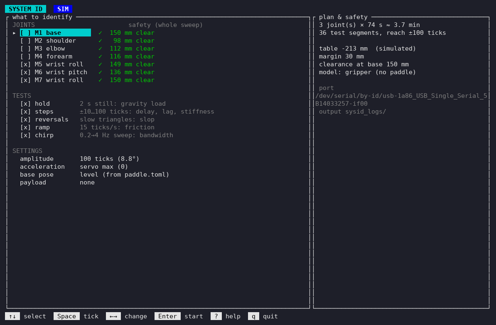
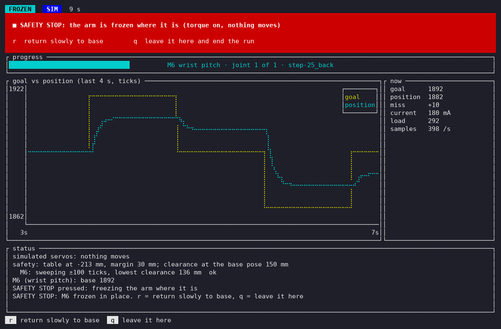
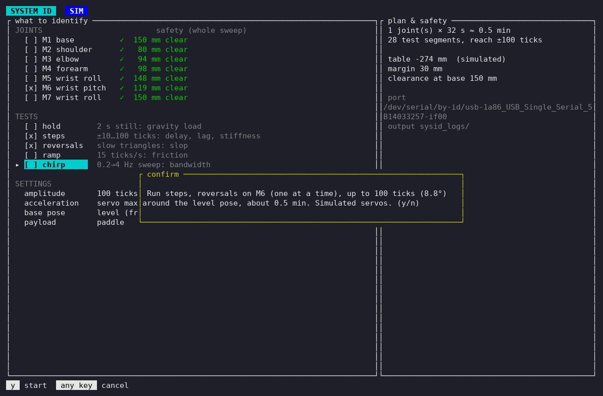
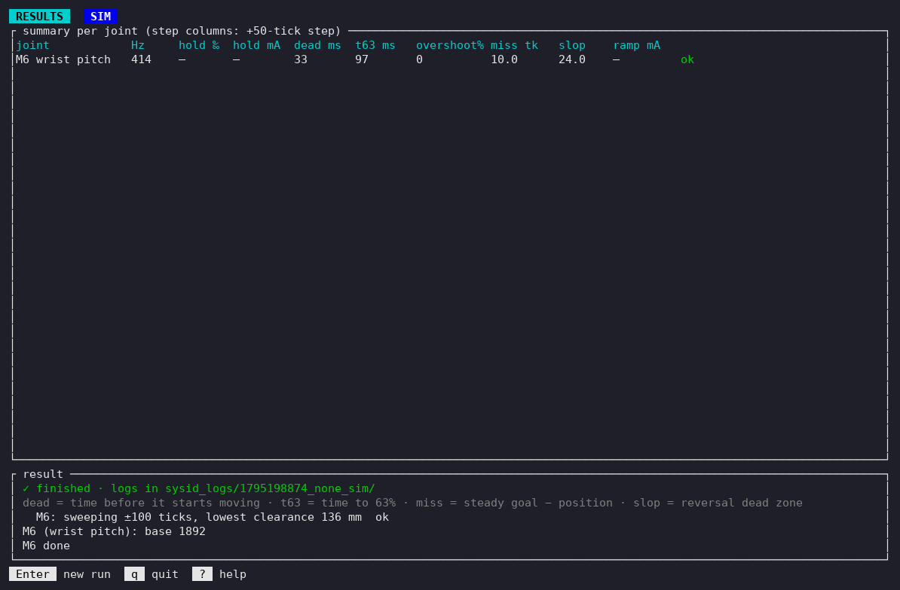

# ElRobotSysId

Per-joint system identification of the **ElRobot** follower's Feetech ST3215 servos. It records the data needed to give a
**MuJoCo** model of the arm realistic actuators (sim2real2sim), for
[RoboSim #69](https://github.com/spinworks-tech/RoboSim/issues/69). The balancing controller that motivated it is in
[PingPongSimBot](https://github.com/robomotic/PingPongSimBot).

The first real ping-pong runs showed that **the servos dominate the real behaviour**: about 150 ms from goal to position and
about 1.7° of slop on M6. A simulator without those effects won't transfer in either direction. This tool measures them.


**Download:** prebuilt Raspberry Pi 4/5 (aarch64) binaries are on the
[Releases](https://github.com/robomotic/ElRobotSysId/releases) page (`elrobot-sysid-aarch64-linux` + `.sha256`). They need glibc ≥ 2.39 (Debian 13 / Raspberry Pi OS trixie, Ubuntu 24.04+)
and no other libraries. Otherwise, build from source as below.
## What it does

It excites **one joint at a time** around a base pose while all other joints hold (the gripper keeps its grip). It logs goal,
position, speed, load and current at the **full bus rate** (several hundred Hz, using direct serial access).

| Test | Signal on the joint | Identifies (MuJoCo) |
|---|---|---|
| hold | 2 s still | static gravity load and current at the pose |
| steps | +a, 0, −a, 0 for a = 10, 25, 50, 100 ticks | dead time, lag (`dyntype="filter"` / delay), `kp`, `damping`, overshoot |
| reversals | slow triangles of ±5, 10, 20 ticks | slop: backlash / dead zone (modelled in the control wrapper) |
| ramp | out and back at 15 ticks/s | `frictionloss` (breakaway current), compliance under load |
| chirp | 20 ticks, log sweep 0.2 → 4 Hz over 25 s | frequency response: bandwidth, phase lag; checks `armature`/`damping` |

About **74 s per joint**: about 3.7 min for the wrist (M5–M7). 4096 ticks = one turn (1 tick ≈ 0.088°).

## Full-screen app

`elrobot-sysid` with no arguments opens a keyboard-driven app (the same keys as
[PingPongSimBot](https://github.com/robomotic/PingPongSimBot)); `elrobot-sysid --sim` runs it on **simulated servos**
(transport delay, first-order lag, per-joint dead zones as measured on the real arm), so nothing moves.






**Pose screen** (`p` in Setup): move the arm by hand **without the station**, for example to a better base pose before a
run. ↑↓ choose a joint (M1–M8, gripper included), ←→ move it one step (1 · 5 · 10 · 25 · 50 ticks with `+`/`-`), `l`
goes smoothly to the level pose, `g` to the pose given with `--target t1,…,t7` (all joints together; both ask first
and check the whole path), **Space freezes**, Esc releases the bus and goes back to Setup. Real arm: needs ARMED
(`a`). Every step is checked before it is written: inside the joint's **calibrated range** (± 5 ticks), and the whole way
keeps the table margin. While moving, the measured pose is checked every 30 ms and the arm freezes below the margin.
The table shows each joint's angle, its room to the ends of its range, load, current and temperature.


<details>
<summary>More: confirmation, results, and the line-based dry run</summary>





On the simulated M6 (then 30 ms delay, 70 ms lag, 20-tick dead zone) it measured a dead time of 32 ms, t63 of 99 ms, a
steady miss of 10 ticks (half the dead zone) and 24 ticks of slop: the method recovers what it is meant to find. The
simulator now uses the real arm's timing (80 ms delay, 80 ms lag).

Line-based dry run (plan + safety report, no motion):


With an uncalibrated geometry every joint reads **TOO CLOSE**, the expected fail-safe result (see the safety section).
</details>

| Key | |
|---|---|
| ↑ ↓ | move between joints, tests and settings |
| Space | tick / untick a joint or test |
| ← → | amplitude, acceleration, base pose, payload |
| Enter | start (real arm: needs ARMED and a measured table height; asks first) |
| a | ARM / disarm (switches itself off after 30 s without a key) |
| **Space** | **while running: SAFETY STOP**: freezes the arm where it is (goal = present position, torque stays on so nothing drops). Then `r` returns slowly to base, `q` leaves it there |
| Esc | while running: stop gently, the joint returns to base · otherwise quit |
| Ctrl-C | emergency: freeze, leave the arm where it is, quit |
| ? | help |

A frozen joint stops within one command delay (~30 ms). If it was moving fast it coasts about 1° and settles inside
its dead zone; after that it does not move until you press `r`. The line-based run (`--cli`): Ctrl-C stops and
returns to base; a second Ctrl-C skips the moves back.

Each joint's safety clearance over its whole sweep is shown live while you choose. A joint that would come within the
margin of the table shows **✗** with the largest safe amplitude, and the run refuses to start.

## Build (on the Pi)

```bash
curl https://sh.rustup.rs -sSf | sh -s -- -y --profile minimal
sudo apt install protobuf-compiler libudev-dev    # st3215 build.rs (protoc), serial port
cargo build --release
cargo test                                        # 14 tests: signals, estimators, safety (incl. stop), simulated servo, settings
```

`st3215` (the ST3215 packet codec and register map) comes from [norma-core](https://github.com/norma-core/norma-core) as a pinned git
dependency.

## Run

```bash
sudo systemctl stop normacore-station          # this tool needs exclusive use of the follower bus
B=target/release/elrobot-sysid

$B --sim                                       # full-screen app, simulated servos: try it anywhere
$B --sim --cli --joints 3,6                    # same, line-based: writes logs without the arm (e.g. for the fitters)
$B --stall 6 --into 1 --lever-mm 160           # STALL TEST: fingertips onto a kitchen scale, type the readings (asks first)
$B                                             # full-screen app on the real arm
$B --dry-run                                   # plan + safety report; nothing moves
$B --cli --joints 5,6,7                        # line-based run on the wrist (no paddle); asks [y/N] first
$B --cli --joints 1,2,3,4 --payload none --max-amp 50   # shoulder/elbow, paddle removed, smaller moves

sudo systemctl start normacore-station
```

Options:

| Option | Meaning |
|---|---|
| `--port` | follower bus. Default: `/dev/serial/by-id/usb-1a86_USB_Single_Serial_5B14033257-if00` |
| `--config paddle.toml` | optional PingPongSimBot config: port, level pose and grip are read from it |
| `--base current\|level` | test around the current pose (default) or the `level` pose from the config |
| `--max-amp` | largest excursion in ticks (default 100, hard cap 200) |
| `--acc` | servo acceleration register during the tests (0 = servo maximum); restored afterwards |
| `--tests` | any of `hold,steps,reversals,ramp,chirp` |
| `--payload` | label for what the arm carries: goes into the folder name and the metadata |
| `--cli` | line-based run instead of the full-screen app |
| `--sim` | simulated servos: the full-screen app, or a line-based run with `--cli` |
| `--yes` | skip the confirmation (line-based run) |
| `--safety sysid_safety.toml` | table height, margin, tool spheres, tick→angle convention |
| `--set-table-z-mm` | record the measured table height (base frame) and exit |
| `--show-clearance` | read-only: modelled heights and clearance at the current pose |

## Table safety area (required before any run)

The arm sits on a table and must never hit it ([issue #1](https://github.com/robomotic/ElRobotSysId/issues/1)):

```bash
$B --show-clearance                 # read-only: modelled height of every joint and tool sphere now; compare with a ruler
$B --set-table-z-mm 0               # MEASURED table height in the robot base frame (mm); runs are refused until set
$B --dry-run --base level           # per joint: lowest clearance over the planned sweep, and the largest safe --max-amp
```

- Forward kinematics with positions (URDF joint origins). The gripper (motor, jaws) and the **wrist camera** (always
  mounted: U20CAM on its 27 mm mount, up to 67 mm from the gripper) are modelled as spheres in the gripper frame
  (`tool_spheres` in `sysid_safety.toml`). The camera sits on top of the gripper; its 42 mm sphere is fitted around the
  CAD-registered camera geometry from [RoboSim](https://github.com/spinworks-tech/RoboSim) (`innomaker_u20cam`).
- The **paddle is not modelled** by default: system identification runs without it. Choose payload `paddle` (or
  `paddle+ball`) and its sphere (`paddle_spheres`) is added.
- Before anything is written to the servos: every joint's full planned sweep (and the move to the base pose) must stay
  at least `margin_m` (30 mm) above the table, or the run is refused with the largest safe amplitude per joint.
- While running: the measured pose is checked every sample; below the margin the joint stops and returns to base.

**Calibrated (2026-11-21..23): [`sysid_safety.toml`](sysid_safety.toml) in the repo is the checked configuration**
for the follower it was measured on: tick→angle `sign = +1` and `zero` from the station viewer's mapping (each motor's
calibrated range spread over the URDF joint limits, matched at level), the calibrated ranges, the table at 0 mm (base
clamped onto the table), the tool, camera, paddle and boom spheres. It was checked with the viewer, `--show-clearance`
and a ruler. On another arm the geometry carries over, but **check your own table height** (`--set-table-z-mm`) and
**your calibrated ranges/zeros** (station viewer, then `--show-clearance` and a ruler) before anything moves. Every field
is explained in the file.

## Output

`sysid_logs/<unix stamp>_<payload>/`:
- `meta.toml`:
  - run arguments, base pose and start pose;
  - the **EEPROM and RAM settings of all 8 servos**: P/D/I coefficients, CW/CCW dead zones, max torque, offset,
    acceleration, torque limit; the limits and protection settings (temperature, voltage, protection current, protection
    time, protective and overload torque, unloading conditions); plus raw hex;
  - a **per-joint summary**: hold load and current; for each step, dead time, t63, overshoot and steady error; reversal slop;
    ramp peak current.
- `M<n>.csv`: one row per bus sample, with columns
  `t, segment, test, goal, position, speed, load, current_ma, voltage_dv, temp_c`.

Units: position and goal in ticks (4096 per turn); speed in ticks/s (sign-magnitude decoded); load in 0.1% of max torque
(signed; this is the PWM duty); current in mA (6.5 mA per raw unit; the ST3215 reports the magnitude only); voltage in 0.1 V; temperature in °C. Temperature
and voltage have short glitches (1–4 samples, e.g. 26 → 99 °C during motion): filter them (the fitter uses a median).

## Safety

- Excursions are capped at 200 ticks (17.6°).
- Before anything moves, all 8 servos must answer.
- It stops when a joint stays at ≥ 90% load for 0.3 s (blocked), ends up more than 300 ticks from its goal (collision or slip), or 5
  reads in a row fail.
- Ctrl-C, or any of those stops, brings the joint back to base. The acceleration register is restored.
- M8 (gripper) is never excited. Its saved grip (from the config) is re-applied at start.

## Using the data in MuJoCo (plan)

1. Position actuator per joint: `kp` from the step steady error under the known gravity load (hold test) and the step speed;
   `forcerange` from ST3215 stall torque (2.94 N·m in the URDF), checked against the load at saturation.
2. Lag: first-order filter time constant plus a pure delay, fitted to the step responses and the chirp phase.
3. `damping` and `armature` (rotor inertia × gear ratio²) from overshoot and chirp; `frictionloss` from the ramp.
4. Slop: MuJoCo has no native backlash in the 3.x API. Add a deadband in the control wrapper with the measured reversal slop
   (check what MuJoCo 4.1 offers first).
5. Electrical and thermal model ([#2](https://github.com/robomotic/ElRobotSysId/issues/2)): a DC motor behind the gearbox,
   `duty·V_bus = R·i + Ke·N·ω`, as a MuJoCo `general` actuator with `ctrl` = motor voltage, so the simulation gives each
   joint's current and voltage; then the servo's overload protection and a two-node heating model on top.
   `tools/fit_electrical.py <session>` fits R and Ke·N per joint and writes `<session>/electrical.toml` (with the protection
   settings and an MJCF actuator line). **The ST3215 reports the supply current**, `|duty|·i_motor`, as a magnitude: at
   standstill under load R then comes out 3.9–4.2 Ω on M2–M4 (25–36 Ω if read as motor current; datasheet 4.4 Ω). With R
   fixed, `|duty·V_bus − Ke·N·ω| = R·i/|duty|` gives **Ke·N 1.5–2.0 V·s/rad** on every joint, loaded or not. The servo
   reports the load with the opposite sign to the speed; the fit finds the sign. From the gravity-loaded holds
   (approached from both sides) and MuJoCo gravity torques: **Kt·η·N ≈ 1.6–1.8 N·m/A** and a gearbox **static friction
   of 0.25–0.41 N·m** (that is why holds read zero load: the gearbox carries the arm). Runs without a loaded standstill
   use R 4.1 Ω.
6. **Servo step loop in MuJoCo** (`tools/servo_sim.py`, laptop, needs `mujoco`): every joint is an ST3215 with
   transport delay (80 ms), a P loop on the tick error producing duty (dead zone, 50 % cap), the DC motor
   (R, Ke·N, Kt·η·N → torque through `qfrc_applied`), gearbox stiction (`frictionloss` made stiff with noslip; MuJoCo's
   default lets a held arm creep), the servo's own overload protection (25 % for 2 s → 20 %; 3.25 A) and a two-node
   heating model (constants are placeholders until a thermal test). It reports what the servo would: position, load,
   **supply** current, temperature. `replay <session> --joint N --fit` drives it with a logged run's goals and fits
   dead zone and static friction: loaded M2/M3/M4 match to 4.2/4.5/2.9 ticks RMS, unloaded M7 to 4.9 (friction depends
   on the load: ~0.3 N·m loaded, ~0.05 unloaded); M3's best friction (0.30 N·m) equals the hold estimate.
   `tools/fit_torque.py <session>` gives Kt·η·N and static friction from the two-sided holds and MuJoCo gravity;
   `tools/elrobot_model.py` is the shared URDF/tick mapping (contacts off: the URDF meshes overlap by up to 28 mm).

   
7. **Stall test** (`--stall <joint> --into ±1 --lever-mm <mm>`, line-based): torque per amp **without the URDF
   masses** (printed parts make them uncertain). The joint presses a lever (or the fingertips) into a kitchen scale at
   0 → 5 → 10 → 20 → 30 → 40 → … → 0 ticks; at each level it holds, measures duty and current, and you type the
   reading in grams. Fit: `torque = Kt·η·N·i_motor + b ∓ friction` (up/down), written to
   `sysid_logs/<stamp>_stall_M<n>/stall.{csv,toml}`. Checked first: table clearance and range over the sweep; stops
   above 30 % duty or if the joint runs > 15 ticks past its goal (the lever slipped).
   **Set-up A (recommended): a printed boom on the M8 horn, fingers off.** The horn carries the servo's full torque
   by design, so the load goes straight into the servo and nothing fragile is in between.

   

   | | |
   |---|---|
   | File | [`hardware/stall_boom_m8.stl`](hardware/stall_boom_m8.stl), made by `tools/make_stall_boom.py` |
   | Interface | copied from norma-core `Gripper_Gear`: 4 × Ø3.4 holes on a Ø14 circle, Ø7 centre, Ø23.6 × 3.15 mm recess over the horn, 2.85 mm under the screw heads, so **the gear's own 4 M3 screws fit** |
   | Standoff | tube Ø34/Ø22, 20 mm: the gripper base reaches 12 mm in front of the horn and ±40 mm sideways; the Ø22 bore lets a screwdriver reach the screws from the front |
   | Arm | 100 mm from the axis to the nub, 14 × 8 mm; nub R 5 mm on the lower edge |
   | Print | PETG or PLA, arm face down on the bed, 100 % infill (or 6 walls); ~34 g |

   1. **Mark the gear's angle on the horn**, then unscrew its 4 M3 screws (the horn stays on the servo); the jaws come
      off with the gear. Putting the gear back at the same angle keeps the station's gripper calibration valid.
   2. Screw the boom on with the same screws, arm pointing sideways (the hole pattern allows 90° steps), nub down.
   3. At the level pose the M8 axis is ~129 mm above the table, the nub's lowest point ~117 mm: put the kitchen scale
      on a stack so the nub just touches it. Measure the lever (horizontal distance from the M8 axis to the nub's
      contact), ~100 mm.
   4. On the Pose screen, step M8 by 1–5 ticks to see which direction presses the nub down (`--into`); use payload
      `boom` in the app while it is on.
   5. `elrobot-sysid --config ~/paddle-ws/paddle.toml --stall 8 --into <±1> --lever-mm 100`

   **Set-up B (no print): the fingertips on M6.** Close the gripper; put the scale under the fingertips at level
   (~125 mm above the table, ~190 mm in front of the base). Higher M6 ticks press down (`--into 1`); lever ~160 mm:
   `elrobot-sysid --config ~/paddle-ws/paddle.toml --stall 6 --into 1 --lever-mm 160`.

   With the default `--stall-max 20` the motor puts out ≤ ~0.4–0.85 N·m (depending on the true Kt·η·N).
   A first boom design on the camera mount was **withdrawn**: the camera base is fragile and would have carried the
   whole joint torque.
8. Validate by replaying logged goal sequences, from these runs and from PingPongSimBot runs, in sim and comparing positions.

## License

Apache License 2.0, see [LICENSE](LICENSE).
